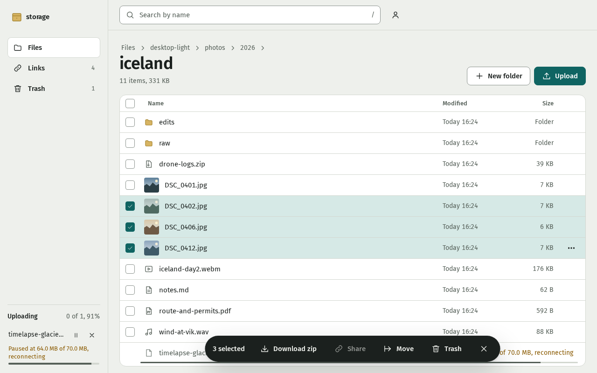
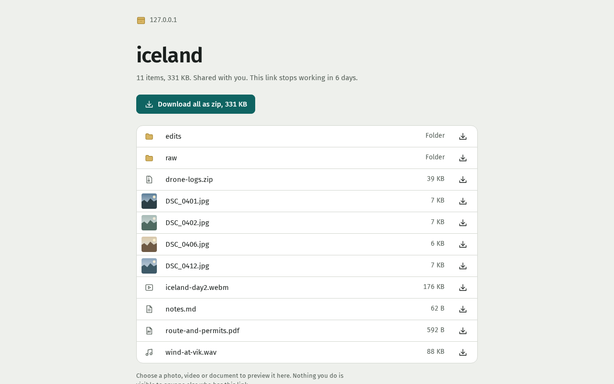

# storage-server

A self-hosted file server for one owner and the people they send links to. Browse an existing folder, upload resumable files, preview media and PDFs, and share files or folders. Drop links accept uploads without showing the folder. Deleted files stay in recoverable trash for 30 days.




## Start the server

Use Linux with Docker Engine, Docker Compose, and OpenSSL installed. Run these commands from this checkout as your normal user. The first image build downloads the Node and Go build tools.

```sh
mkdir -p data state
cp .env.example .env
sed -i "s/^PUID=.*/PUID=$(id -u)/; s/^PGID=.*/PGID=$(id -g)/; s/^GRAFANA_PASSWORD=.*/GRAFANA_PASSWORD=$(openssl rand -hex 24)/" .env
docker compose up -d
docker compose logs app
```

If port 8080 is already occupied, change `PORT`, `PUBLIC_URL`, and `SHARE_URL` in `.env`, then run `docker compose up -d` again.

Open http://localhost:8080, or the port you selected. Use the `setup_code` in the app log to create your owner password. The code is required even on the first visit. Keep `.env` private. Grafana's password is required even when monitoring is disabled because Compose validates all service variables.

`STORAGE_ROOT` and `STATE_DIR` must exist before startup. Both must be writable by the numeric `PUID` and `PGID` in `.env`. Compose refuses a missing directory instead of creating one as root. A permission error at startup means you must fix the directory ownership. The default host binding accepts connections only from this machine. Set `BIND_ADDR=0.0.0.0` deliberately to allow LAN access.

Check the running app with:

```sh
docker compose exec app /storage-server healthcheck
```

Uploads stop before free space drops below `MIN_FREE_BYTES`, which defaults to 5 GiB.

## Serve an existing folder

Set `STORAGE_ROOT` in `.env` to the absolute path of your folder, then recreate the app with `docker compose up -d`. No import or migration is needed. The old stack's storage folder works as is after it is mounted on Linux. Files already there appear immediately. The app creates a private `.storage-server` directory inside that folder.

Set `STATE_DIR` to a separate directory for the account database and thumbnails. Do not point it inside the served folder. Ensure the configured user can read and write the folder and the state directory. Stop the old file server before changing files with this app.

## Add PDF tools

```sh
docker compose --profile pdf up -d
```

Open http://localhost:8082/pdf/. Stirling PDF is a separate tool and does not browse your storage folder. Its uploads are temporary. With the Tailscale profile, open `https://<machine>.<tailnet>.ts.net:8444/pdf/`. PDF stays private to the tailnet and the loopback host port. In-app PDF previews work without this profile.

## Add monitoring

```sh
docker compose --profile monitoring up -d
```

Open Grafana at http://localhost:3000 with username `admin` and your generated `GRAFANA_PASSWORD` from `.env`. The provisioned Storage server dashboard shows disk free space, transfer bytes, active uploads, trash items, shares, login failures, and recovery actions. Prometheus is at http://localhost:9091 and scrapes the private ops listener. Both host ports bind only to loopback.

## Add Tailscale

Enable HTTPS in your tailnet. Put a Tailscale auth key in `TS_AUTHKEY`, choose `TS_HOSTNAME`, and set `PUBLIC_URL` and `SHARE_URL` to your HTTPS tailnet URL in `.env`.

```sh
docker compose --profile tailscale up -d
```

The official sidecar uses userspace networking. It needs no host device, Docker socket, or extra capabilities. Its identity persists under `STATE_DIR/tailscale`. `TS_EXTRA_ARGS` accepts options such as `--login-server` for a self-hosted control server.

The owner app uses tailnet HTTPS port 443. To send public guest links, enable Funnel in your tailnet, set `TS_EXPOSE=funnel`, and set `SHARE_URL=https://<machine>.<tailnet>.ts.net:8443`. Run the same profile command again. Funnel port 8443 reaches only the guest listener. It cannot reach login, owner operations, PDF tools, or metrics. The owner app stays on private tailnet port 443. PDF uses private port 8444.

Specify every profile you want to start, or set `COMPOSE_PROFILES` in `.env` to a comma-separated list. Existing services keep running when you start another profile.

The isolated Headscale proof verified HTTP routing through two clients. Production HTTPS certificates and public Funnel reachability still need verification on a real tailnet. See [the operations proof](docs/design/ops-proof.md).

## Back up and restore

Stop the stack before copying state, so the SQLite database and storage describe the same moment.

```sh
docker compose --profile monitoring --profile pdf --profile tailscale stop
```

Back up both configured directories and `.env`, preserving ownership and hidden files. `STATE_DIR` holds `state.db`, its SQLite journal files, disposable thumbnail cache, and the sidecar identity if enabled. The database holds the owner, sessions, share links, grants, and pending move recovery records. Treat it as a credential.

`STORAGE_ROOT` holds your files and `.storage-server`. That hidden directory holds trash, resumable upload spools, and lock state. Do not remove it or omit it from a backup. Restore the storage and state directories from the same backup, restore their ownership, and run `docker compose up -d` with the profiles you use. A database backup alone cannot restore files or trash.

## Recover a lost password

Stop the app, run `reset-owner` against its existing state, then start it again.

```sh
docker compose stop app
docker compose run --rm --no-deps app reset-owner
docker compose up -d app
docker compose logs app
```

Use the new setup code to create a password. Recovery revokes owner sessions. Files and share links remain in place. Never edit `state.db` by hand.

## Build and check changes

Install Go 1.27, Node 26, and pnpm 12.16.1. JavaScript package management uses pnpm.

```sh
pnpm --dir web install --frozen-lockfile
pnpm --dir web typecheck
pnpm --dir web test
pnpm --dir web build
go vet ./...
go test -race ./...
go test -tags harness -timeout 8m ./harness
pnpm --dir web exec playwright install chromium
pnpm --dir web test:e2e
HARNESS_COMPOSE=1 go test -tags harness -run '^TestCompose$' -v -timeout 12m ./harness
```

The harness uses a real disk directory under your home cache. Set `HARNESS_DIR` to select another real disk. `HARNESS_LONG=1` adds multi-gigabyte and soak tests. The Compose test builds a real image, verifies setup, upload, download, restart persistence, and profile configuration, then removes its own containers and volumes. Playwright runs headless. CI installs Chromium's system dependencies on Ubuntu before running it.

## Limits

- Linux only. The storage filesystem must support `openat2`, `RENAME_NOREPLACE`, and directory fsync. Startup probes refuse an unsupported filesystem.
- One storage mount. Moves across nested mounts or btrfs subvolumes fail instead of copying non-atomically.
- Symlinks appear in listings but do not open. The app never follows them outside the storage root.
- Info-ZIP `unzip` rejects streamed ZIP archives over 4 GiB. 7z reads them. Windows Explorer and macOS Archive Utility are untested.
- One owner account. No sync client, WebDAV, S3, version history, office editor, or video transcoding.
