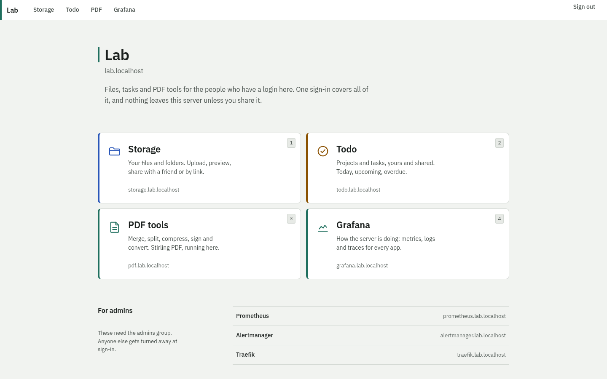

# storage-server

A self-hosted platform for you and your friends, on Kubernetes. One sign-in opens all of it:

- **Storage**: your files and folders. Upload whole folders, resume big uploads, and preview images, video, audio, PDF, code, Markdown, CSV, JSON, ZIP listings and Office documents in the browser. Share a file or folder with a friend (read or edit), or send a public link with a password, an expiry and a download limit.
- **Todo**: projects, sections, subtasks, labels, priorities, due dates, recurring tasks, reminders and quick add (`Pay rent tomorrow 9am p1 #Home every month`). Share a project with a friend; their changes appear on your screen live.
- **PDF**: Stirling PDF for merging, splitting, compressing, signing and converting.
- **Home**: the portal with a door to every app.
- **Observability**: Grafana with metrics, logs and traces for every app, alerts, and a k6 load generator that exercises all of it.



## Start it

You need Linux with systemd, `sudo`, Docker (it builds the app images), `helm`, `jq`, `envsubst`, `openssl`, `curl`, `make` and the time zone data (`tzdata`). `make up` installs a single-node [k3s](https://k3s.io) server system-wide and imports the app images into it with `sudo`, so it asks for your password, and again later in the run if sudo's cached credential has expired. The pinned `kubectl` and k3s binaries are downloaded into `.local/` and checksum-verified.

```sh
make up      # install k3s and deploy everything (about 8 minutes from scratch, 3.5 to rerun)
make creds   # print the URLs and the generated logins
```

Open **https://lab.localhost**. It sends you to sign in, then to the Home portal. Your browser warns about the certificate until you trust `.local/ca.crt`; [platform/README.md](platform/README.md#trust-the-local-ca) shows how.

| App | URL | Who |
|---|---|---|
| Home | https://home.lab.localhost | everyone with a login |
| Storage | https://storage.lab.localhost | everyone with a login; public links work for anyone |
| Todo | https://todo.lab.localhost | everyone with a login |
| PDF tools | https://pdf.lab.localhost | everyone with a login |
| Grafana | https://grafana.lab.localhost | admins |
| Prometheus, Alertmanager, Traefik | `prometheus.`, `alertmanager.`, `traefik.lab.localhost` | admins |

Add a friend with `scripts/users.sh add <username> <email>`. It prints their password. Add `--admin` to give them the admin group.

Locally the apps listen only on `127.0.0.1`. k3s's own API server and kubelet listen on every interface and require client certificates; [platform/README.md](platform/README.md#security-on-the-server) says when to firewall them. To let a friend in from their own device, use the `remote` profile: a real domain or your Tailscale address, Let's Encrypt certificates, and two-factor sign-in. See [platform/README.md](platform/README.md#run-it-for-friends-remote-profile).

## Everyday commands

| Command | What it does |
|---|---|
| `make up` | Create or update everything. Safe to rerun. |
| `make status` | Nodes, releases, unhealthy pods, volumes, routes, certificates. |
| `make deploy-storage`, `make deploy-todo`, `make deploy-home` | Rebuild one app and roll it out. |
| `make smoke` | Security and platform checks against the running cluster. |
| `make e2e` | Browser tests of the main journeys through real sign-in. |
| `make load-smoke`, `make load-load`, `make load-stress` | k6 runs inside the cluster; results land in Grafana. |
| `make backup`, `make restore` | Dump both databases to the host now; restore the newest dumps. |
| `make down CONFIRM=1` | Uninstall k3s from this machine, which deletes the cluster. Your files, backups and `.local/` stay on disk. |

## How it fits together

```
browser ──https──▶ Traefik ──forward-auth──▶ Authelia (one sign-in, sets Remote-User)
                      │
                      ├─▶ Home     (nginx, static portal)
                      ├─▶ Storage  (Go + React) ──▶ PostgreSQL (CloudNativePG)
                      │                         ├─▶ files on the host (DATA_DIR)
                      │                         └─▶ Stirling PDF (Office previews)
                      ├─▶ Todo     (Fastify + React, 2 replicas) ──▶ PostgreSQL
                      ├─▶ Stirling PDF
                      └─▶ Grafana, Prometheus, Alertmanager (admins)

every app ──OTLP──▶ Alloy ──▶ Tempo (traces)      pod logs ──▶ Alloy ──▶ Loki
Prometheus scrapes every app, database, Traefik and Authelia; k6 remote-writes into it
```

- Traefik strips any `Remote-*` header a client sends, then asks Authelia. Apps trust the headers only because NetworkPolicies let traffic in from Traefik alone. `make smoke` proves both.
- Files and database dumps live under `DATA_DIR` on the host and survive `make down`. The live databases don't: run `make backup` first, or changes since the last nightly dump are lost.
- Uploaded HTML, SVG and XML are never rendered on the app's origin. PDFs render with pdf.js; Markdown renders with raw HTML disabled.

## Where to read more

| Topic | File |
|---|---|
| The contract every part builds against | [docs/architecture.md](docs/architecture.md) |
| Why it is built this way | [docs/decisions.md](docs/decisions.md) |
| Running the platform, friends, backups, remote profile | [platform/README.md](platform/README.md) |
| Observability: signals, dashboards, alerts | [platform/observability/README.md](platform/observability/README.md) |
| Storage app: API, metrics, security | [services/storage/README.md](services/storage/README.md), [API.md](services/storage/API.md), [docs/security.md](services/storage/docs/security.md) |
| Todo app: API and metrics | [services/todo/README.md](services/todo/README.md), [API.md](services/todo/API.md) |
| Stirling PDF API calls | [platform/stirling-pdf/README.md](platform/stirling-pdf/README.md) |
| Load testing | [loadgen/README.md](loadgen/README.md) |
| Design direction | [docs/design/direction.md](docs/design/direction.md) |

## Repo layout

```
cluster/    k3s server config             platform/   Traefik, Authelia, cert-manager, CNPG, Stirling PDF, observability
config/     defaults and pinned versions  services/   storage, todo, home
scripts/    make targets                  packages/ui shared design tokens and CSS
loadgen/    k6 scripts and Jobs           tests/e2e/  platform browser tests
```
