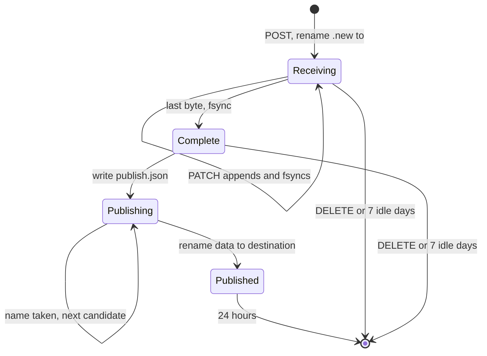
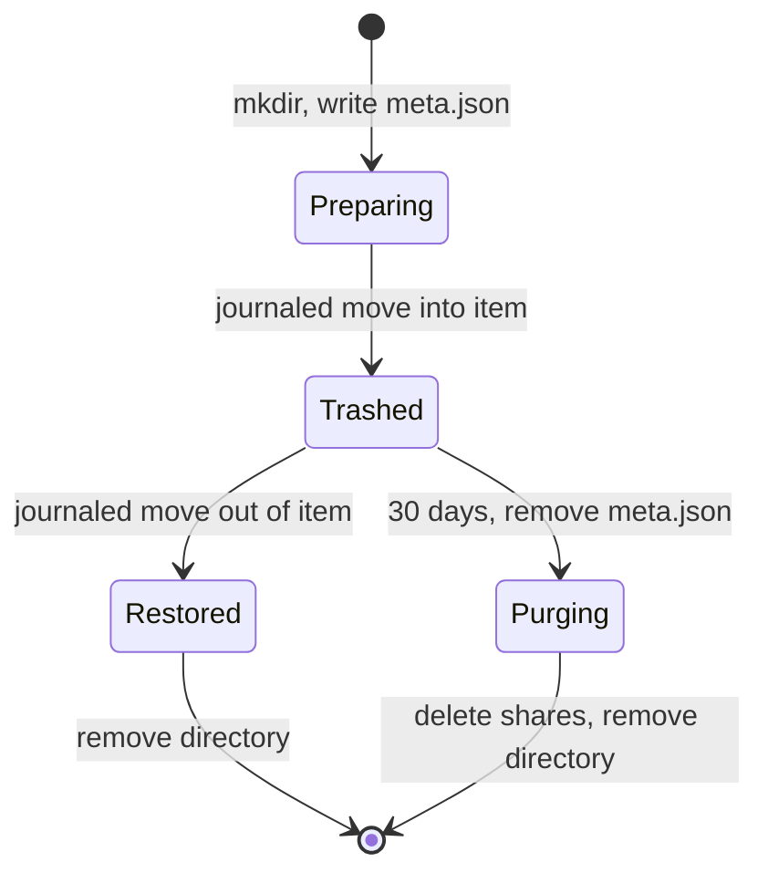
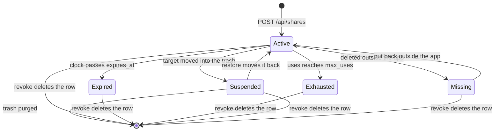

# State machines

There is one recovery order at boot, before any listener opens: `vault.Recover`, then `upload.Recover`. Upload recovery runs second because a drop upload publishes into its share's current target, which the vault may have just corrected. Both are safe to run twice.

The crash names below are the `crash.Point` values. `TestCrashMatrix` runs each scenario once per point.

## Upload

State lives in `.storage-server/spool/<id>/`. `phaseOf` derives it from three facts on disk. No database row exists.

| Phase | `meta.json` | `data` | `publish.json` |
|---|---|---|---|
| Creating | In `<id>.new/` | None | None |
| Receiving | Yes | Size under length | None |
| Complete | Yes | Size equals length | None |
| Publishing | Yes | Size equals length | Yes |
| Published | Yes | None | Yes |
| Doomed | None | Any | Any |

| Crash | What the disk holds | What restart does | What the client sees |
|---|---|---|---|
| Before `upload.after-create` | `<id>.new/` | Removes it | POST failed. It retries with a new upload. |
| `upload.after-create` | Receiving, no `data` | Keeps it | POST may have lost its answer. A retried POST makes a second upload, and the orphan expires in 7 days. |
| `upload.mid-append` | Receiving, `data` holds what reached the kernel | Keeps it | HEAD returns the stat size. PATCH resumes there. Measured in E5. |
| `upload.after-sync` | Complete | Publishes | HEAD returns the full offset, so the client finishes. |
| `upload.after-publish-intent` | Publishing | Redoes publish. If the chosen name is now taken, it takes the next one. | HEAD returns the full offset. |
| `upload.after-publish` | Published | Keeps the tombstone | HEAD returns the full offset and the stored path. |
| After tombstone removal starts | No `meta.json` | Removes the directory | 404, after the 24 hour window only. |

A partial file is never in the tree. The destination name appears only through a rename from a fully fsynced `data`, and renames tore zero of 4457 files in E3.

A complete drop upload whose share is suspended stays Complete. Each hourly sweep retries it until the idle TTL. A complete drop upload whose share no longer exists is removed.

## Trash item

State lives in `.storage-server/trash/<id>/`, as `meta.json` (`{originalPath, name, kind, deletedAt}`) and `item`, the moved file or folder. The item is listed only when both exist. Each move goes through the journal in the next section.

| Directory holds | Means | What restart does |
|---|---|---|
| `meta.json` only | Preparing, or Restored | Removes the directory. The file is at its live path either way. |
| `meta.json` and `item` | Trashed | Keeps it |
| `item` only, or neither | Purging | Deletes shares under it, then removes the directory |

| Crash | What the disk holds | What restart does | Result |
|---|---|---|---|
| `trash.after-meta` | File live, `meta.json` alone | Removes the directory | Delete did not happen. The client retries. |
| `move.after-intent` during trash | Same, plus a journal row | Destination is absent, so drops the row, then as above | Delete did not happen. |
| `move.after-rename` during trash | Trashed, journal row | Destination exists, so commits: shares move into the trash and suspend | Delete happened. |
| `move.after-commit` during trash | Trashed | Nothing | Delete happened. |
| `move.after-intent` during restore | Trashed, journal row | Drops the row | Restore did not happen. Item intact. |
| `move.after-rename` during restore | File live, `meta.json` alone, journal row | Commits, shares resume, directory removed | Restore happened. |
| `restore.after-commit` | File live, `meta.json` alone | Removes the directory | Restore happened. |
| `purge.after-meta` | `item` alone | Deletes shares, removes the directory | Purge finishes. It can no longer be listed or restored, so a half-removed folder is never offered. |
| `purge.after-shares` | `item` alone | Removes the directory | Purge finishes. |
| `purge.mid-remove` | Part of `item` | Removes the rest | Purge finishes. |

No step removes the only copy of a file before the rename that preserves it, because a rename moves one inode and both parents are fsynced before the journal commits. Losing the database loses no trash item, since the directory is the whole record.

## Share link

A share row holds `target`, `expires_at`, `max_uses` and `uses`. `access.StateOf` derives the state from that row, the clock and one stat. No state column exists.

| State | Derived from |
|---|---|
| Suspended | `target` starts with `trash:` |
| Missing | `target` is live and the path does not exist |
| Expired | `expires_at` is in the past |
| Exhausted | `uses` equals `max_uses`, for a guest without a consumed grant |
| Active | None of the above |

Trash is a location, so a new file uploaded at a trashed path cannot revive the old link. The link is no longer looking at that path.

Every relocation runs one function, `vault.relocate`, with `v.mu` held:

1. Check the destination is absent.
2. `BeginMove` writes a `pending_moves` row.
3. `disk.Move` runs `renameat2(RENAME_NOREPLACE)` and fsyncs both parents.
4. `CommitMove` rewrites shares and deletes the row, in one transaction.

If step 3 fails, `AbortMove` deletes the row and the error returns. On restart, each row gets one rule: if the destination exists, run step 4, otherwise delete the row.

| Crash | What exists | What restart does | Result |
|---|---|---|---|
| `move.after-intent` | Old path, journal row | Destination absent, drops the row | The move did not happen. Link works. |
| `move.after-rename` | New path, journal row, shares still on the old path | Destination exists, commits | The move happened. Link works. |
| `move.after-commit` | New path | Nothing | Link works. |

Other share operations are one SQLite transaction each, so a crash leaves them fully done or not done: create, revoke, and consuming a grant, which marks the grant and increments `uses` together. A purge's share deletion is reached by the trash recovery above.
